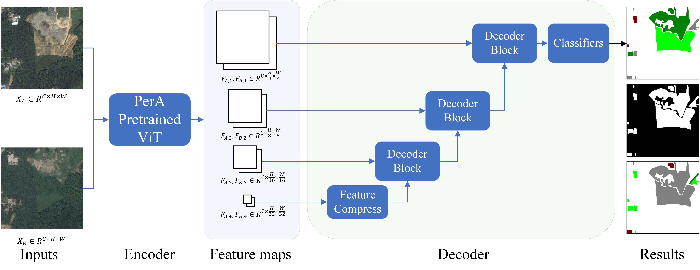
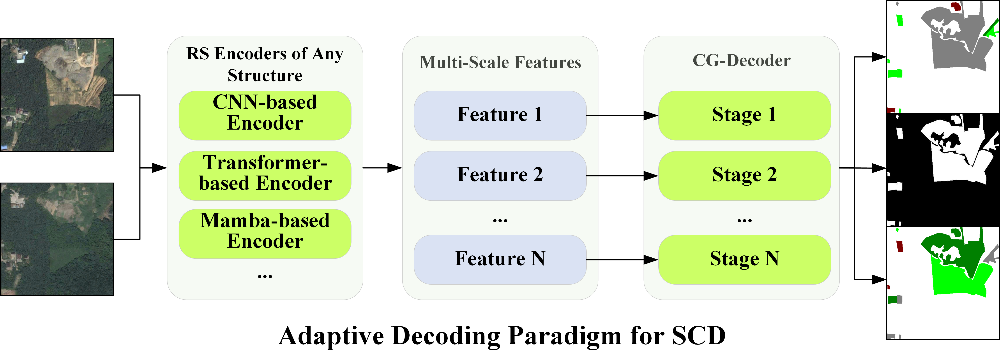
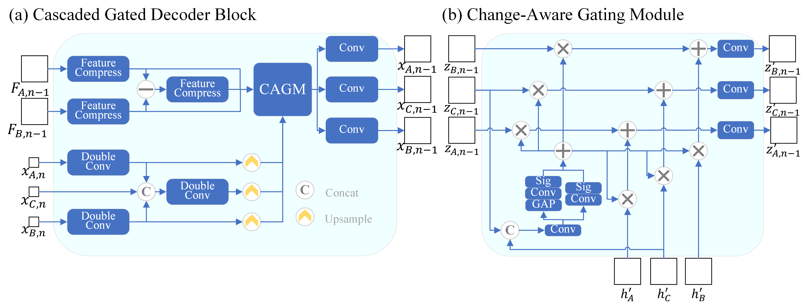

# PerASCD: Foundation Model-Driven Semantic Change Detection in Remote Sensing Imagery

<p align="center">
  
</p>

<p align="center">
  <a href="https://arxiv.org/abs/2602.13780"></a>
  <a href="#"></a>
  <a href="#"></a>
  <a href="#"></a>
  <a href="#"></a>
</p>

> Official implementation of **PerASCD**, a semantic change detection framework with a plug-and-play encoder interface and a **Cascade Gated Decoder (CG-Decoder)**. See paper for more details: [Foundation Model-Driven Semantic Change Detection in Remote Sensing Imagery](https://arxiv.org/abs/2602.13780).

## News

- `[26 Oct 2026]` Released the SECOND checkpoint with Fscd = 66.59 on [Hugging Face](https://huggingface.co/SathShen/PerASCD-Checkpoint).
- `[25 May 2026]` Code released.
- `[14 Feb 2026]` Paper uploaded to arXiv.

## Overview

Semantic change detection identifies changed regions in bi-temporal remote sensing images and predicts their semantic categories before and after the change.

This repository provides:

- A unified training and evaluation pipeline for semantic change detection.
- Multiple encoder backbones: `PerA`, `VMamba-B`, `SwinV2-L`, and `ResNet50`.
- A Cascade Gated Decoder (CG-Decoder) for multi-scale feature fusion.
- Support for the SECOND and LandsatSCD datasets.
- An interface for adding custom encoders.

---

## Plug-and-Play Semantic Change Detection Framework

The CG-Decoder progressively integrates deep semantic features with shallow encoder features while modeling changes between bi-temporal inputs.

<p align="center">
  
</p>

Each decoder block combines feature compression, difference modeling, and change-aware gated fusion to refine semantic and change features.

<p align="center">
  
</p>

## Installation

### Create an Environment

```bash
conda create -n perascd python=3.10 -y
conda activate perascd
```

### Install Dependencies

```bash
python -m pip install -r requirements.txt
```

The PerA environment uses PyTorch 2.7.1, CUDA 12.8, and torchvision 0.22.1.
An existing environment that passes the model tests can also be used.
Other encoders may require additional dependencies.

### PerA Runtime

PerA uses PyTorch's `grid_sample` for deformable attention and SDPA for self-attention when xFormers is absent. No custom CUDA compilation or xFormers installation is required.

The ViT-Adapter implementation is contained in `models/pera_layers/vit_adapter.py`.
The PerA backbone repository is available at [SathShen/PerA](https://github.com/SathShen/PerA).

## Dataset Preparation

Processed datasets use single-channel `uint8` index labels.

| Source | Download |
|---|---|
| Hugging Face | [PerASCD datasets](https://huggingface.co/datasets/SathShen/PerASCD-datasets) |
| Baidu Disk | [Download](https://pan.baidu.com/s/1iw76eP3KSBy2jOP_ypfTNA?pwd=vt5z) |

Expected directory structure:

```text
SECOND/
├── train/
│   ├── im1/
│   ├── im2/
│   ├── label1/
│   └── label2/
└── val/
    ├── im1/
    ├── im2/
    ├── label1/
    └── label2/
```

Images and labels for each sample must have matching filenames across the four directories.
Other datasets follow the same directory structure.

| Label value | Meaning |
|---|---|
| `0` | Unchanged; ignored by the semantic cross-entropy loss |
| `1` to `N` | Semantic classes in changed regions |

SECOND uses seven label values: `0` for unchanged and `1` to `6` for semantic classes.
Unchanged pixels are still included in change detection and evaluation.

## Pretrained Models

| Model | Source | Usage |
|---|---|---|
| PerA foundation backbone | [SathShen/PerA](https://github.com/SathShen/PerA) | Initialize training with `--pretrained-path` |
| PerASCD trained on SECOND | [Hugging Face checkpoints](https://huggingface.co/SathShen/PerASCD-Checkpoint) | Evaluate with `--load-path` or fine-tune with `--finetune-path` |

Download the required checkpoint and replace the example paths below with its local path.
A complete PerASCD checkpoint does not require a separate foundation checkpoint for evaluation.

## Training

### Train with the PerA Backbone

```bash
CUDA_VISIBLE_DEVICES=0 python train.py \
  --encoder pera \
  --pretrained-path /path/to/pera_pretrained.params \
  --data-name SECOND \
  --data-path /path/to/SECOND \
  --train-batch-size 4 \
  --val-batch-size 4 \
  --grad-accum-steps 2 \
  --log-root ./logs \
  --note pera_second
```

Training hyperparameters retain the defaults in `train.py`. Configuration uses command-line arguments.
For PerA on SECOND, `input-size=448` configures the backbone's positional embeddings, while images and final predictions are 512 × 512.

### Fine-Tune a Full Checkpoint

Use `--finetune-path` to load model weights and start with a fresh optimizer and epoch count:

```bash
CUDA_VISIBLE_DEVICES=0 python train.py \
  --encoder pera \
  --data-name SECOND \
  --data-path /path/to/SECOND \
  --finetune-path /path/to/perascd_second.pth \
  --note pera_second_finetune
```

This command uses the default training hyperparameters. Set `--lr` and `--epochs` explicitly if a different fine-tuning schedule is needed.

### Resume Training

For checkpoints saved by the current training script, use `--load-path` to restore the model, optimizer, saved epoch, and best Fscd:

```bash
CUDA_VISIBLE_DEVICES=0 python train.py \
  --encoder pera \
  --data-name SECOND \
  --data-path /path/to/SECOND \
  --load-path /path/to/training_checkpoint.pth \
  --note pera_second_resume
```

Keep the training settings consistent with the original run. `--epochs` specifies the total number of epochs, including those already completed.
Use only one initialization option: `--pretrained-path`, `--finetune-path`, or `--load-path`.
Old Docker checkpoints must use `--finetune-path` for training because their optimizer parameter order differs.

### Train with Other Backbones

For example, to train with VMamba-B after installing its additional dependencies:

```bash
CUDA_VISIBLE_DEVICES=0 python train.py \
  --encoder vmambaB \
  --pretrained-path /path/to/vmamba_base.pth \
  --data-name SECOND \
  --data-path /path/to/SECOND \
  --train-batch-size 8 \
  --val-batch-size 8 \
  --grad-accum-steps 1 \
  --input-size 512 \
  --amp-dtype fp32 \
  --note vmamba_second
```

Select other backbones using `--encoder` and supply the corresponding pretrained weights.

### Checkpoints and TensorBoard

Validation runs after each epoch. A checkpoint is saved when validation Fscd exceeds the previous best, initially zero. Checkpoint filenames include the epoch and validation metrics:

```text
encoder_XXe_mIoUXX.XX_SekXX.XX_FscdXX.XX_OAXX.XX.pth
```

Runs are stored under `log_root/dataset/encoder/timestamp_note/`.
TensorBoard events are written to the `tensorboard/` subdirectory and record epoch losses, validation metrics, and learning rates.

```bash
tensorboard --logdir ./logs
```

Validation metrics in TensorBoard use their raw scale; console output and checkpoint filenames display percentages.

## Evaluation

Evaluate a complete checkpoint on the SECOND validation split:

```bash
CUDA_VISIBLE_DEVICES=0 python evaluate.py \
  --encoder pera \
  --data-name SECOND \
  --data-path /path/to/SECOND \
  --split val \
  --input-size 448 \
  --output-size 512 \
  --norm-profile pera \
  --val-batch-size 1 \
  --load-path /path/to/perascd_second.pth \
  --out-dir ./eval/SECOND \
  --save-preds \
  --gen-conf-matrix
```

Use the same split and normalization as the reference result when comparing accuracy.
Use `--split test` only if a corresponding `test/` directory is available.
For ImageNet-pretrained encoders such as ResNet50, VMamba-B, or SwinV2-L, use `--norm-profile imagenet`.

### Evaluation Outputs

| Output | Contents |
|---|---|
| `eval.log` | Arguments and final Fscd, mIoU, Sek, and accuracy; confusion matrices when `--gen-conf-matrix` is enabled |
| `pred/*_predA.png` | Semantic predictions for the first image, when `--save-preds` is enabled |
| `pred/*_predB.png` | Semantic predictions for the second image, when `--save-preds` is enabled |
| `pred/*_changemask.png` | Binary change masks, when `--save-preds` is enabled |

## Adding a Custom Encoder

To add a new encoder, create a new file under `models/`, for example:

```text
models/my_encoder.py
```

Each encoder file should implement:

```python
def build_model(num_classes, input_size, output_size, drop_rate, pretrained_path=None, freeze_backbone=False):
    encoder = build_encoder(drop_rate, pretrained_path, freeze_backbone)  # Your encoder implementation here
    return SCDNet(
        encoder=encoder,
        in_channel_list=[128, 256, 512, 1024],
        num_classes=num_classes,
        output_size=output_size,
        drop_rate=drop_rate,
        out_channels=128,
    )
```

The encoder should output a list of multi-scale features:

```python
features = [f1, f2, f3, f4]
```

where the resolution is usually:

```text
f1: 1/4
f2: 1/8
f3: 1/16
f4: 1/32
```

Register the encoder in `ENCODER_REGISTRY` in both `train.py` and `evaluate.py`:

```python
ENCODER_REGISTRY = {
    "pera": "models.pera",
    "vmambaB": "models.vmamba",
    "resnet50": "models.resnet",
    "swinV2L": "models.swin",
    "myEncoder": "models.my_encoder",
}
```

Do not forget to set the correct normalization profile for your encoder in `utils/dataset.py`.  
Different pretrained encoders may require different input normalization statistics.

```python
NORM_PROFILES = {
    "imagenet": {
        "mean": (0.485, 0.456, 0.406),
        "std": (0.229, 0.224, 0.225),
    },
    "pera": {
        "mean": (0.3585, 0.3741, 0.3155),
        "std": (0.1483, 0.1283, 0.1198),
    },
}
```

Then update the encoder-to-normalization mapping:

```python
ENCODER_TO_NORM = {
    "pera": "pera",
    "vmambaB": "imagenet",
    "resnet50": "imagenet",
    "swinV2L": "imagenet",
    "myEncoder": "imagenet",  # Change this if your encoder uses another normalization profile.
}
```

For example, if your custom encoder is pretrained with ImageNet statistics, use:

```bash
--norm-profile imagenet
```

## Checkpoint Compatibility

The current PerA model uses three fusion blocks without an additional refinement block.
Docker checkpoint parameter names are mapped to the repository names and loaded with `strict=True`.
Missing layers, extra layers, and tensor shape mismatches raise errors.

- Old Docker weights can be used for evaluation or model-only fine-tuning. Their optimizer state cannot be restored with `--load-path`.
- New checkpoints use the repository parameter names and require conversion before use with the unchanged Docker service.
- The SDPA attention path does not retain the `self.attn` visualization cache.

### Legacy Implementation

Paper results and the corresponding checkpoints were released with the legacy implementation.
Use the `legacy` branch to reproduce those results with the matching model code.
Compatibility with the three-block Docker model does not imply compatibility with other legacy architectures.

## License

This project is released under the MIT License.

## Contact

HengtongShen — [shenht@whu.edu.cn](mailto:shenht@whu.edu.cn) or [sathshen@163.com](mailto:sathshen@163.com).
